# Torque · Gestão de Oficina Automotiva

Plataforma web para gerenciamento dos serviços de uma oficina automotiva, desenvolvida como projeto avaliativo da disciplina **Front-end Frameworks** (2º período — ADS).

> Atividade Avaliativa · Grupo 8 · Tema: Plataforma de Gestão de Oficina Automotiva

## Equipe

- João Veiga
- Ricardo Araújo
- Julio Cezar
- Rayane

## Sobre o projeto

O sistema é dividido em três áreas:

- **Área pública** — página inicial, listagem e detalhes dos serviços, informações sobre a oficina e formulário de contato.
- **Painel administrativo** — painel com indicadores e cadastro, consulta, edição e exclusão de serviços, clientes, veículos, ordens de serviço, estoque (com foto da peça e alerta de estoque baixo), agendamentos, pagamentos, relatórios (faturamento por mês, ordens por situação, serviços mais agendados, melhores clientes e peças mais usadas), chat com clientes e mensagens recebidas.
- **Área do cliente** — painel pessoal, cadastro de veículos, visualização de serviços e estoque, solicitação de agendamentos, acompanhamento e avaliação de ordens de serviço, chat com a oficina e edição de perfil.
- **Ordem de serviço em PDF** — botão de impressora nas OS (admin e cliente) gera a ordem completa em A4, com itens, pagamentos e linhas de assinatura; basta escolher "Salvar como PDF".
- **Busca e filtros** — busca sem diferenciar acentos e com várias palavras em todas as listas, filtros por situação, mecânico, período, categoria e marca, contador de resultados e botão para limpar filtros.
- **Layout responsivo** — todas as telas funcionam no celular (menu inferior, tabelas com rolagem lateral e janelas ajustadas à tela).

## Capturas de tela

As imagens abaixo foram feitas com os dados de demonstração (`supabase/dados-demonstracao.sql`). Todas ficam em [`documentacao/capturas/`](documentacao/capturas).

### Área pública

| Página inicial | Catálogo de serviços | Entrar |
|---|---|---|
| 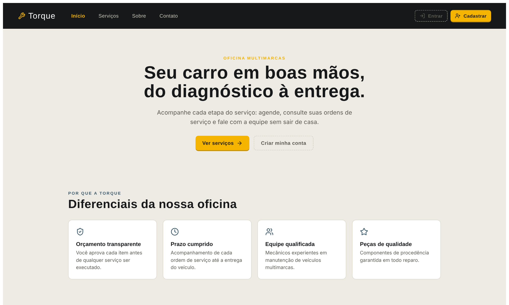 | 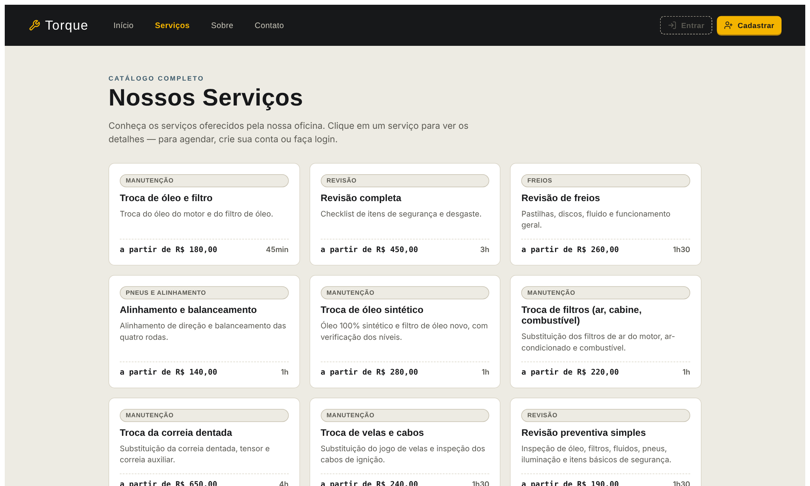 | 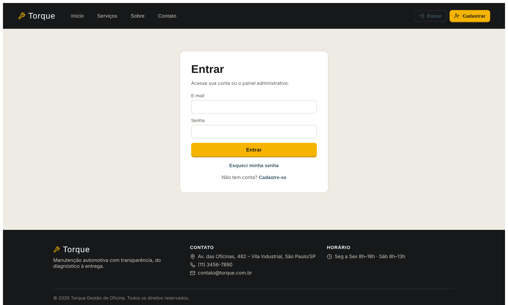 |

### Painel administrativo

| Painel com indicadores | Ordens de serviço | Agendamentos |
|---|---|---|
| 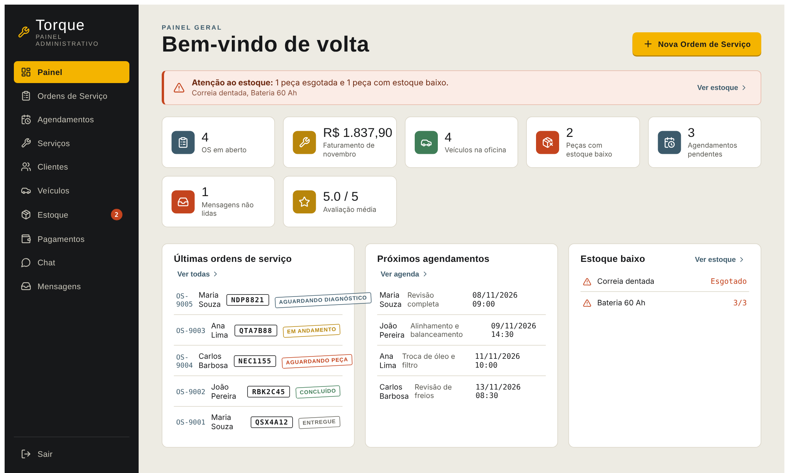 | 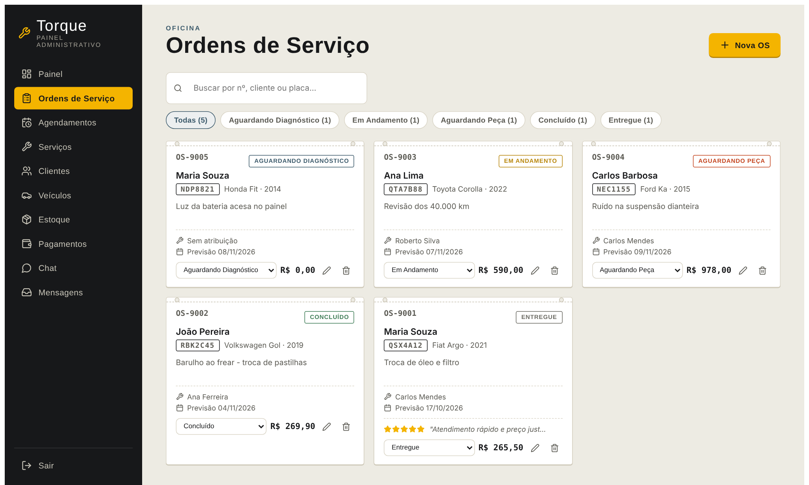 | 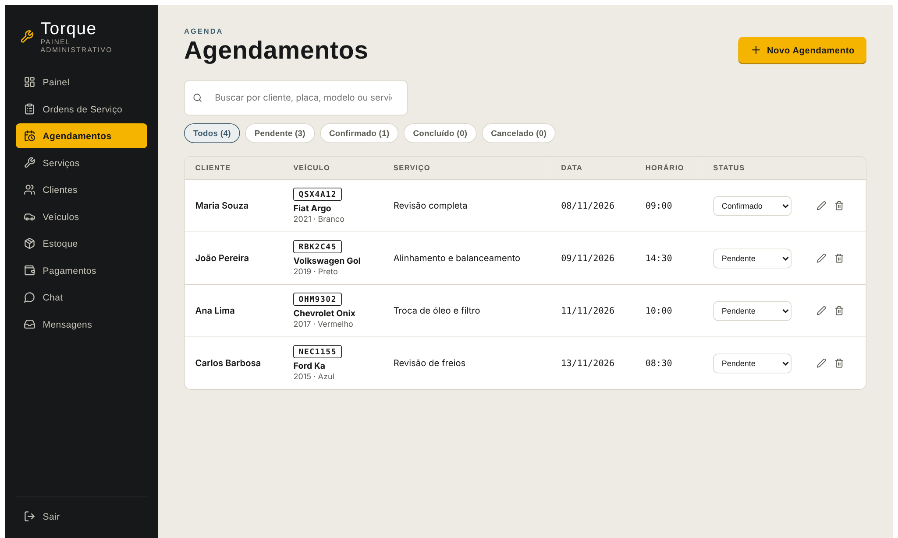 |

| Clientes | Estoque | Pagamentos |
|---|---|---|
| 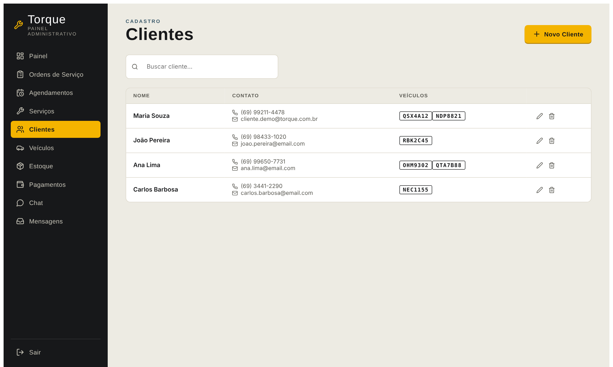 | 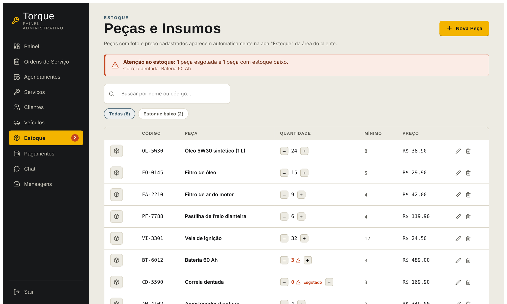 | 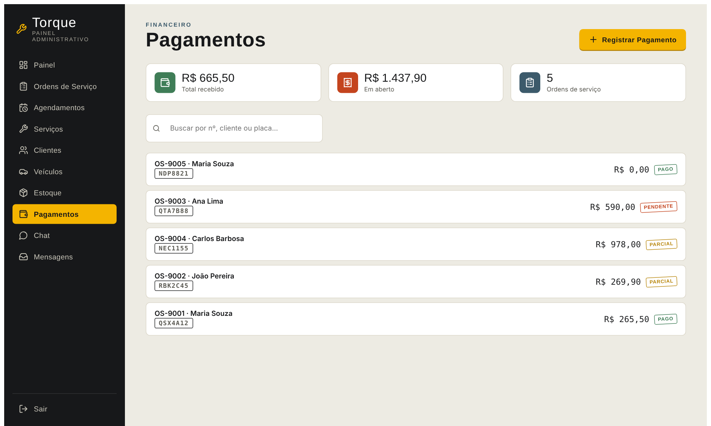 |

| Chat com clientes | Relatórios |
|---|---|
| 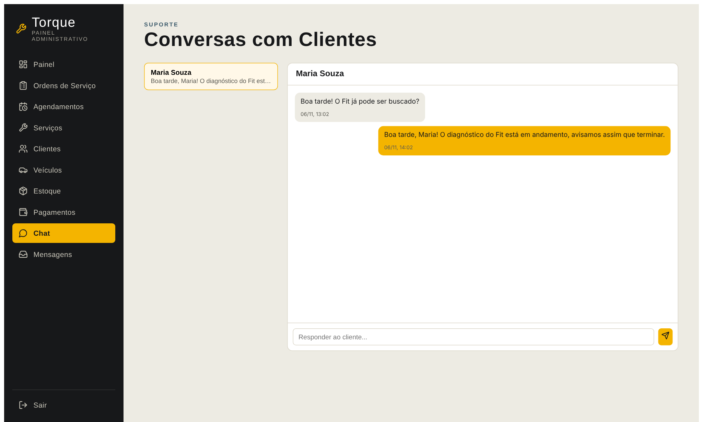 | 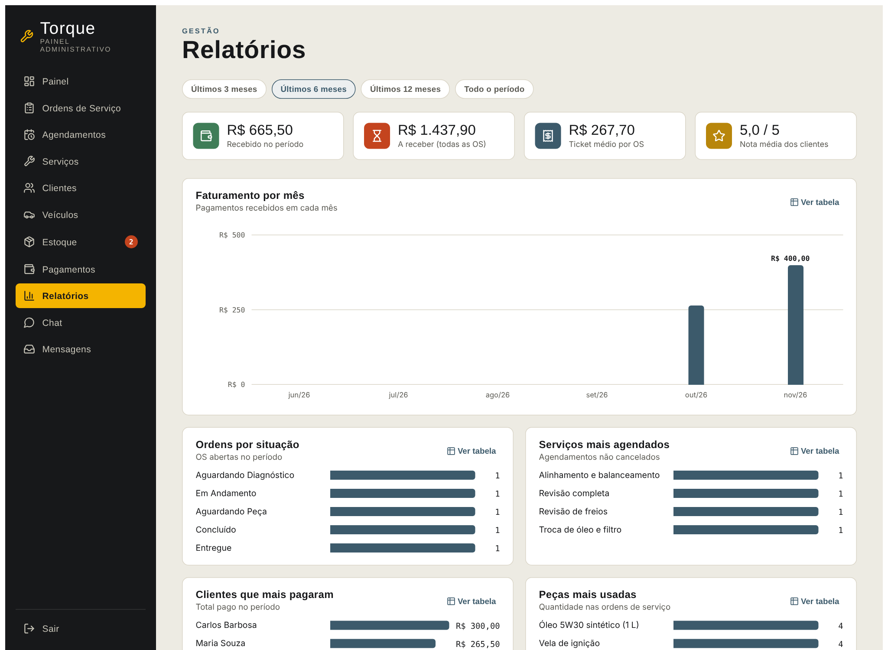 |

### Área do cliente

| Painel do cliente | Meus veículos | Agendar serviço |
|---|---|---|
| 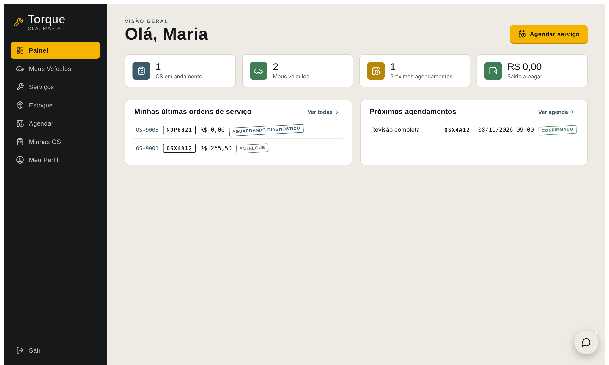 | 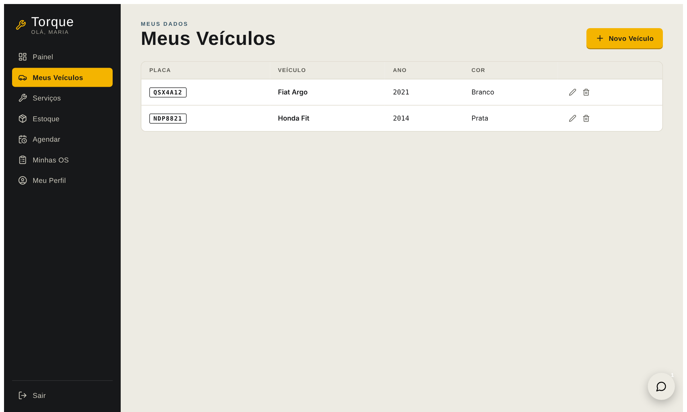 | 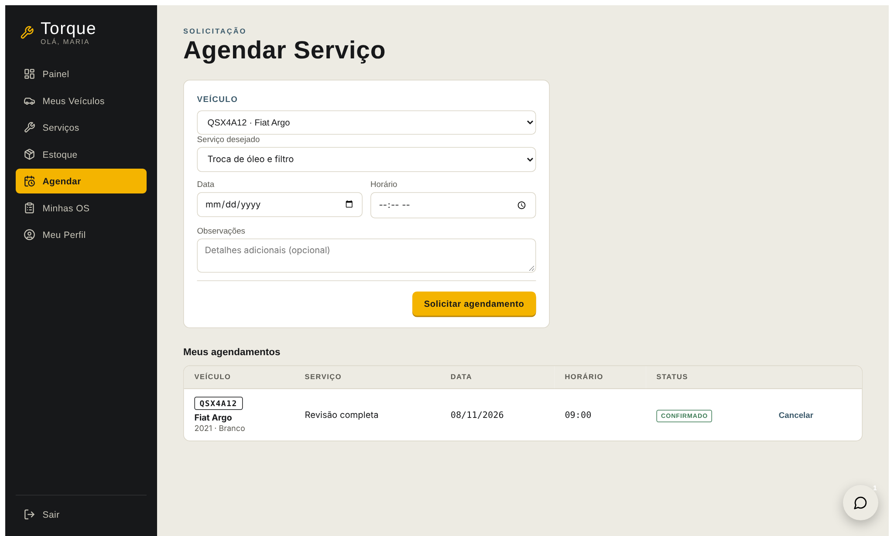 |

| Minhas ordens de serviço |
|---|
| 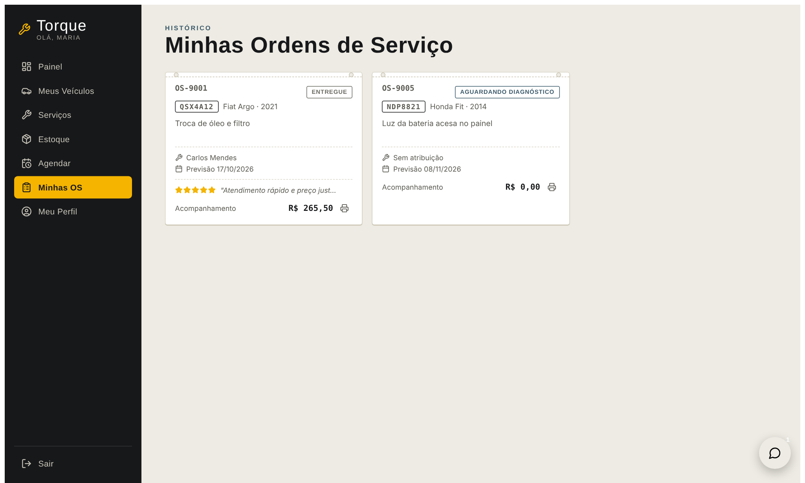 |

## Tecnologias

- **Front-end:** React + Vite, **React Hook Form** (gerenciamento performático de formulários) e **Zod** (validação de schemas e tipagem)
- **Back-end, banco e autenticação:** Supabase (PostgreSQL, Supabase Auth, Storage, Realtime e Row Level Security)

## O que o Supabase e as Validações fazem no projeto

| Recurso | Onde é usado |
|---|---|
| **Validação com Zod & Hook Form** | Formulários de Login, Cadastro de Clientes e Novo Registro validados via schemas dedicados em `compartilhado/validacao/` com mensagens amigáveis em português. |
| **Autenticação** | Cadastro, login, logout, sessão persistente e "Esqueci minha senha" por e-mail |
| **Perfis de acesso** | Administrador e cliente, com regras de acesso (RLS) por tabela e constraints em nível de banco de dados PostgreSQL |
| **Banco de dados (CRUD)** | Clientes, veículos, ordens, estoque, serviços, agendamentos, pagamentos, avaliações, chat e mensagens de contato |
| **Relacionamentos** | Chaves estrangeiras entre as tabelas (veja o diagrama abaixo) |
| **Storage** | Upload da foto das peças do estoque (bucket `pecas`) |
| **Realtime** | Telas atualizam sozinhas quando outra pessoa altera dados (agendamentos, ordens, chat...) |
| **Tratamento de Erros** | Mensagens amigáveis para falhas de autenticação e requisições ao Supabase. |

## Como rodar o projeto

### Pré-requisitos
- Node.js 18+
- Um projeto no [Supabase](https://supabase.com) (plano gratuito serve)

### 1. Instalar e configurar

```bash
npm install
cp .env.example .env        # no Windows (PowerShell): copy .env.example .env
