# Torque · Gestão de Oficina Automotiva

Plataforma web para gerenciamento dos serviços de uma oficina automotiva, desenvolvida como projeto avaliativo da disciplina **Front-end Frameworks** (2º período — ADS).

> Atividade Avaliativa FF · Grupo 8 · Tema: Plataforma de Gestão de Oficina Automotiva

## Equipe

- João Veiga
- Ricardo Araújo
- Julio Cezar
- Rayane

## Sobre o projeto

O sistema é dividido em três áreas:

- **Área pública** — página inicial, listagem e detalhes dos serviços, informações sobre a oficina e formulário de contato.
- **Painel administrativo** — painel com indicadores e cadastro, consulta, edição e exclusão de serviços, clientes, veículos, ordens de serviço, estoque (com foto da peça e alerta de estoque baixo), agendamentos, pagamentos, relatórios (faturamento por mês, ordens por situação, serviços mais agendados, melhores clientes e peças mais usadas), chat com clientes e mensagens recebidas.
- **Área do cliente** — painel pessoal, cadastro de veículos, visualização de serviços e estoque, solicitação de agendamentos, acompanhamento e avaliação de ordens de serviço, chat com a oficina e edição de perfil.
- **Ordem de serviço em PDF** — botão de impressora nas OS (admin e cliente) gera a ordem completa em A4, com itens, pagamentos e linhas de assinatura; basta escolher "Salvar como PDF".
- **Busca e filtros** — busca sem diferenciar acentos e com várias palavras em todas as listas, filtros por situação, mecânico, período, categoria e marca, contador de resultados e botão para limpar filtros.
- **Layout responsivo** — todas as telas funcionam no celular (menu inferior, tabelas com rolagem lateral e janelas ajustadas à tela).

## Capturas de tela

As imagens abaixo foram feitas com os dados de demonstração (`supabase/dados-demonstracao.sql`). Todas ficam em [`documentacao/capturas/`](documentacao/capturas).

### Área pública

| Página inicial | Catálogo de serviços | Entrar |
|---|---|---|
| 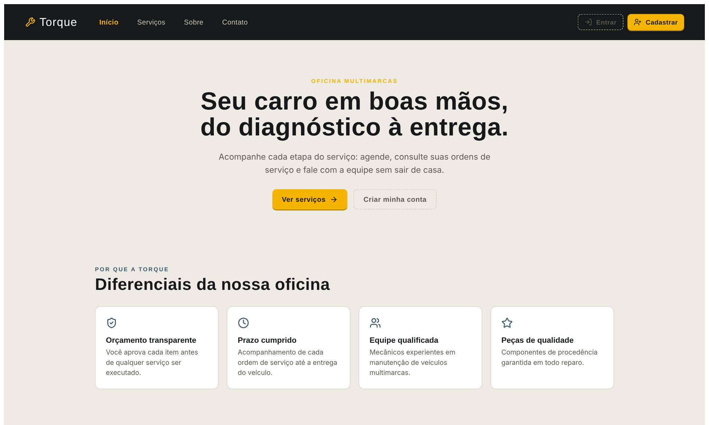 | 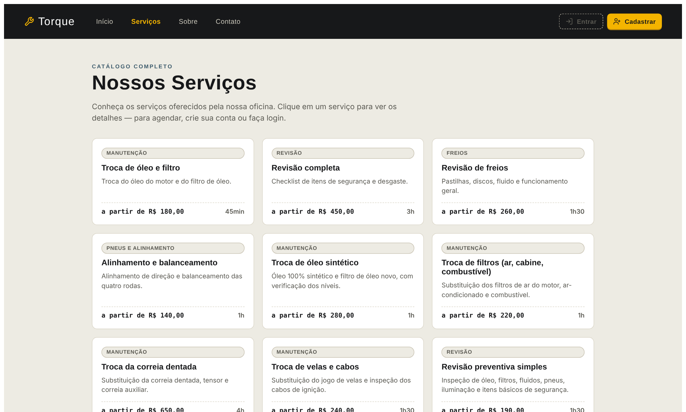 | 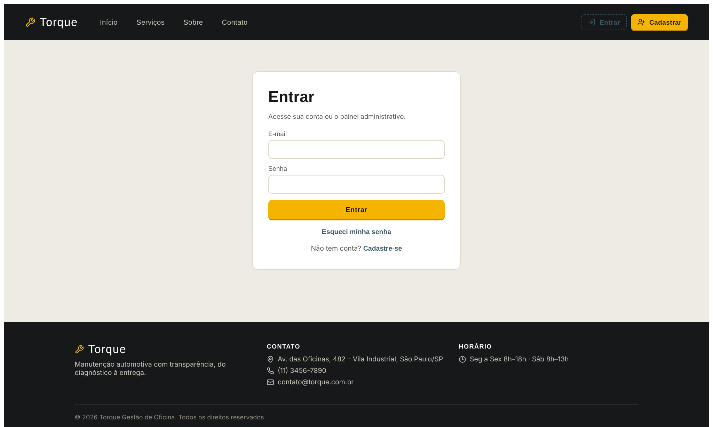 |

### Painel administrativo

| Painel com indicadores | Ordens de serviço | Agendamentos |
|---|---|---|
| 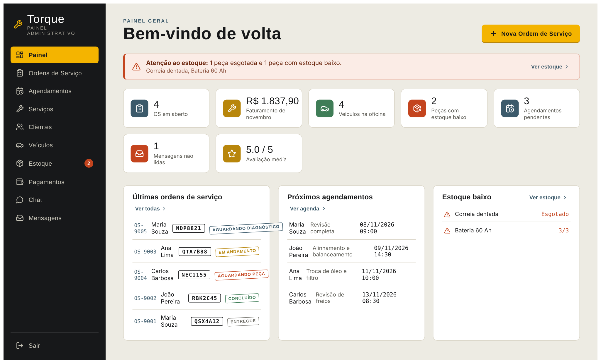 | 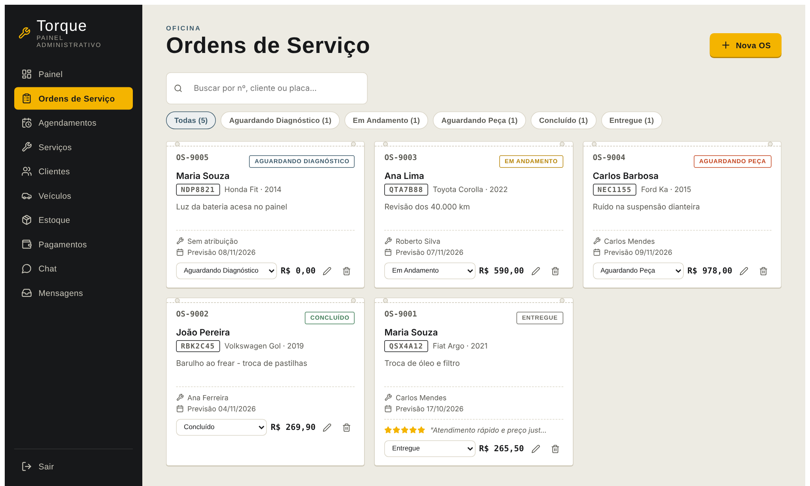 | 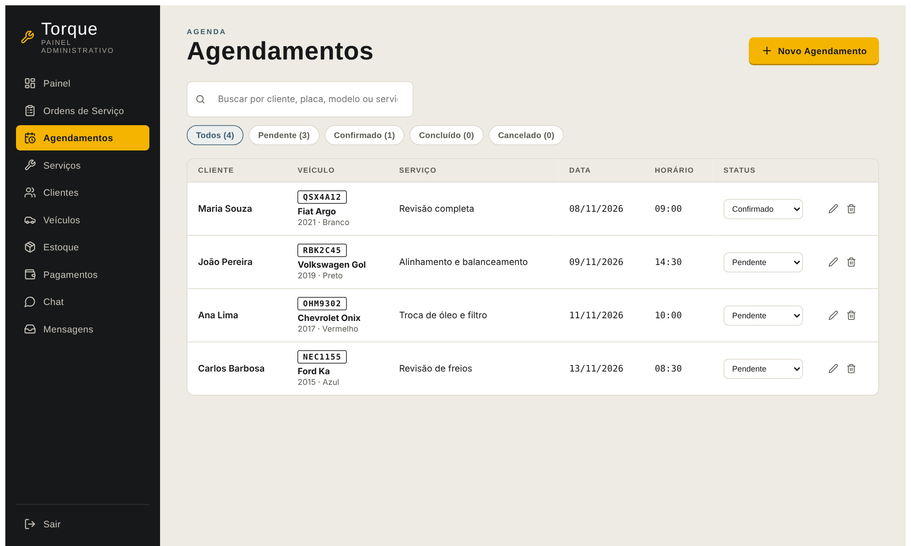 |

| Clientes | Estoque | Pagamentos |
|---|---|---|
| 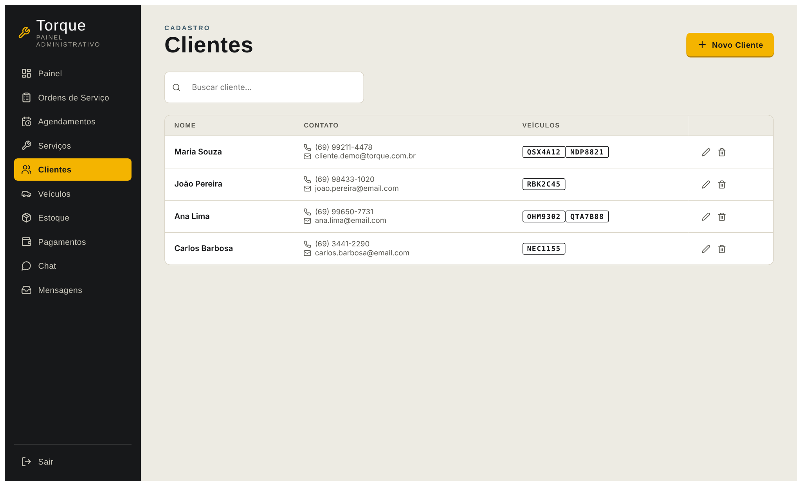 | 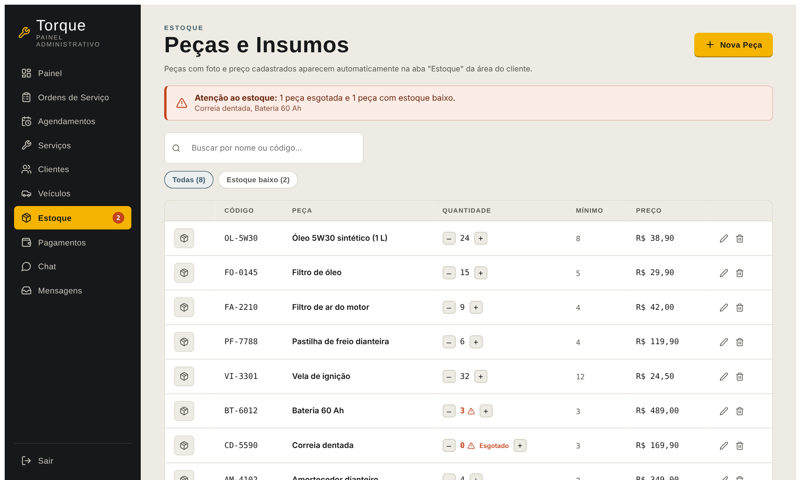 | 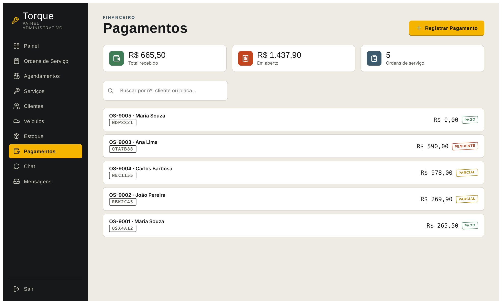 |

| Chat com clientes | Relatórios |
|---|---|
| 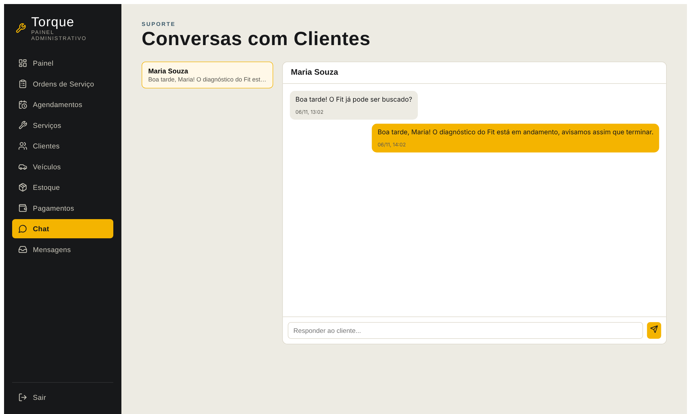 | 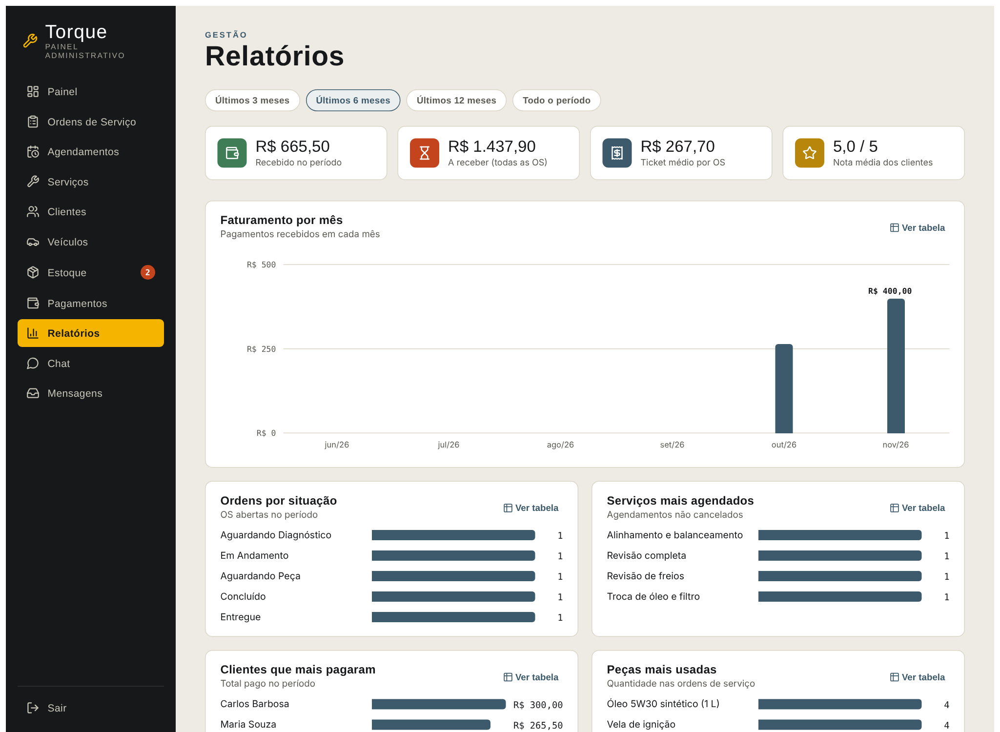 |

### Área do cliente

| Painel do cliente | Meus veículos | Agendar serviço |
|---|---|---|
| 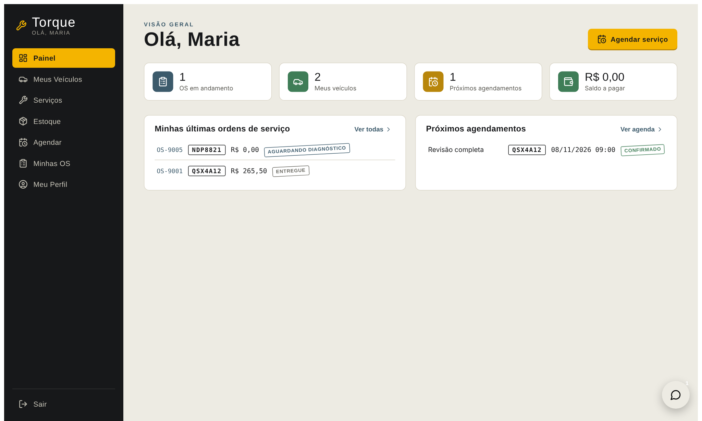 | 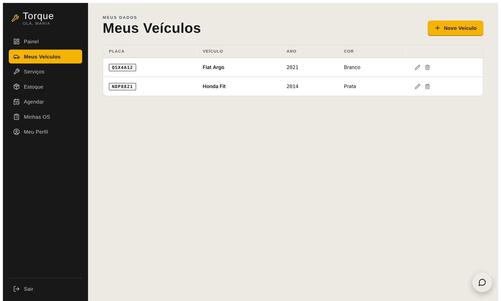 | 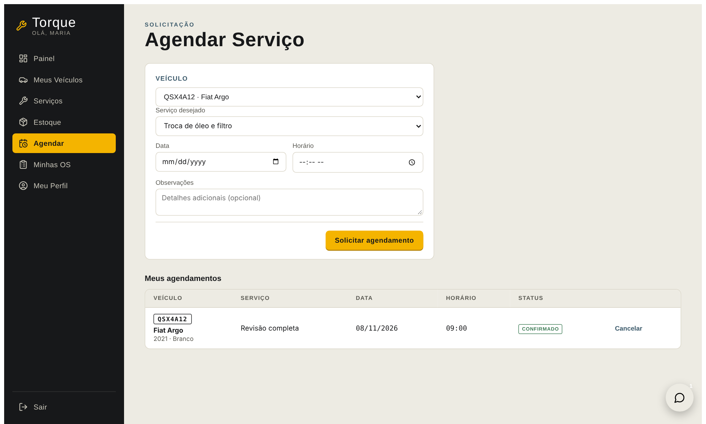 |

| Minhas ordens de serviço |
|---|
| 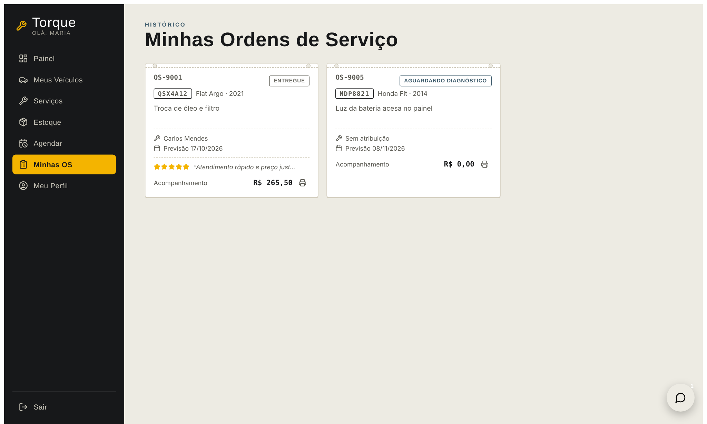 |

## Tecnologias

- **Front-end:** React + Vite
- **Back-end, banco e autenticação:** Supabase (PostgreSQL, Supabase Auth, Storage, Realtime e Row Level Security)

## O que o Supabase faz no projeto (requisitos da AT2)

| Recurso | Onde é usado |
|---|---|
| **Autenticação** | Cadastro, login, logout, sessão persistente e "Esqueci minha senha" por e-mail |
| **Perfis de acesso** | Administrador e cliente, com regras de acesso (RLS) por tabela |
| **Banco de dados (CRUD)** | Clientes, veículos, ordens, estoque, serviços, agendamentos, pagamentos, avaliações, chat e mensagens de contato |
| **Relacionamentos** | Chaves estrangeiras entre as tabelas (veja o diagrama abaixo) |
| **Storage** | Upload da foto das peças do estoque (bucket `pecas`) |
| **Realtime** | Telas atualizam sozinhas quando outra pessoa altera dados (agendamentos, ordens, chat...) |
| **Validações** | E-mail, telefone (com máscara), placa, ano, nome, senha e data de agendamento |

## Como rodar o projeto

### Pré-requisitos
- Node.js 18+
- Um projeto no [Supabase](https://supabase.com) (plano gratuito serve)

### 1. Instalar e configurar

```bash
npm install
cp .env.example .env        # no Windows (PowerShell): copy .env.example .env
```

Abra o `.env` e preencha com os dados do projeto Supabase (**Project Settings → API**):

```
VITE_SUPABASE_URL=https://xxxxx.supabase.co
VITE_SUPABASE_ANON_KEY=chave-anon-ou-publishable
```

> Use somente a chave **anon/publishable**. Nunca a `service_role`. O arquivo `.env` não vai para o GitHub.

### 2. Preparar o banco (SQL Editor do Supabase)

Rode os scripts da pasta [`supabase/`](supabase) nesta ordem:

| # | Script | Para quê |
|---|---|---|
| 1 | `schema.sql` | Tabelas, relacionamentos, regras de acesso (RLS), gatilhos e serviços iniciais |
| 2 | `tempo-real.sql` | Liga as atualizações automáticas (Realtime) |
| 3 | `storage-pecas.sql` | Cria o bucket de fotos das peças |
| 4 | `servicos-extras.sql` *(opcional)* | 20 serviços a mais no catálogo |
| 5 | `dados-demonstracao.sql` *(opcional)* | Clientes, veículos, ordens, agendamentos etc. de exemplo |

Scripts de atualização para quem já tinha o banco de uma versão anterior: `migracao-relacionamentos.sql` e `migracao-chat.sql`. Para remover os dados de exemplo: `limpar-dados-demonstracao.sql`.

### 3. Criar os acessos

**Administrador** — *Authentication → Users → Add user* (e-mail e senha, marcando *Auto Confirm User*) e, no SQL Editor, rode (trocando o e-mail):

```sql
update auth.users
   set raw_app_meta_data = coalesce(raw_app_meta_data, '{}'::jsonb) || '{"role":"admin"}'::jsonb
 where email = 'admin@torque.com.br';
delete from public.clientes where auth_id = (select id from auth.users where email = 'admin@torque.com.br');
```

**Cliente de demonstração** (se rodou o `dados-demonstracao.sql`) — *Add user* com o e-mail `cliente.demo@torque.com.br` (*Auto Confirm User*). Ele é vinculado automaticamente à cliente "Maria Souza", que já tem veículos, ordens e chat de exemplo.

Para o link de "Esqueci minha senha" voltar ao site: *Authentication → URL Configuration* → adicione `http://localhost:5173` em *Site URL* e *Redirect URLs*.

### 4. Rodar

```bash
npm run dev
```

Abra http://localhost:5173. Entre pelo botão **Entrar**: o mesmo login serve para admin e cliente, e o sistema abre a área correta.

## Como funciona o acesso

- **Administrador:** usuário do Supabase Auth com `app_metadata.role = 'admin'`; enxerga e edita tudo.
- **Cliente:** cadastra-se pelo site. Um gatilho cria (ou vincula) a linha em `clientes`. Se o administrador já cadastrou o cliente com o mesmo e-mail, o cadastro é vinculado depois da confirmação do e-mail. O RLS garante que cada cliente só acesse seus próprios veículos, ordens, agendamentos, pagamentos, avaliações e chat.
- **Visitante:** só lê o catálogo de serviços e envia mensagens de contato.

## Estrutura do projeto

O código é dividido em pastas na raiz, organizadas por **funcionalidade**, com um arquivo para cada função/componente.

```
├── aplicacao/            ponto de entrada (main.jsx) e controle de sessão (App.jsx)
├── estilos/              CSS global
├── nucleo/               base da aplicação
│   ├── supabase/         cliente Supabase, lista de tabelas e avisos de falha
│   ├── dados/            leitura, gravação, tempo real e mapeamento camelCase ↔ snake_case
│   └── ganchos/          useTabela (estado + gravação no banco)
├── compartilhado/        peças usadas em vários módulos
│   ├── componentes/      Janela, Campo, Placa, Selo, Carimbo, Estrutura...
│   ├── utilitarios/      formatarReais, formatarData, gerarId, limparDecimal
│   └── validacao/        e-mail, telefone, placa, ano, nome, data
├── modulos/              uma pasta por funcionalidade
│   ├── autenticacao/     entrar, sair, cadastro, sessão, recuperação de senha
│   ├── site-publico/     início, serviços, detalhe, sobre, contato
│   ├── paineis/          áreas do administrador e do cliente + painéis
│   ├── ordens-servico/   ordens de serviço, recibo, avaliação
│   ├── agendamentos/     agenda do admin e solicitação do cliente
│   ├── clientes/         cadastro de clientes e perfil
│   ├── veiculos/         veículos e detalhes do veículo
│   ├── catalogo-servicos/ catálogo de serviços
│   ├── estoque/          peças, estoque e upload de imagens (Storage)
│   ├── pagamentos/       pagamentos por ordem de serviço
│   ├── chat/             chat cliente ↔ oficina
│   └── mensagens/        mensagens do formulário de contato
├── documentacao/         diagrama do banco de dados e capturas de tela
└── supabase/             scripts SQL (schema, migrações, storage, dados de demonstração)
```

Dentro de cada módulo: `telas/` (telas), `componentes/` (janelas e partes de tela), `constantes/`, `utilitarios/` e `integracao/` (chamadas ao Supabase).

## Banco de dados

Diagrama (também em imagem: [`documentacao/diagrama-banco.png`](documentacao/diagrama-banco.png)):

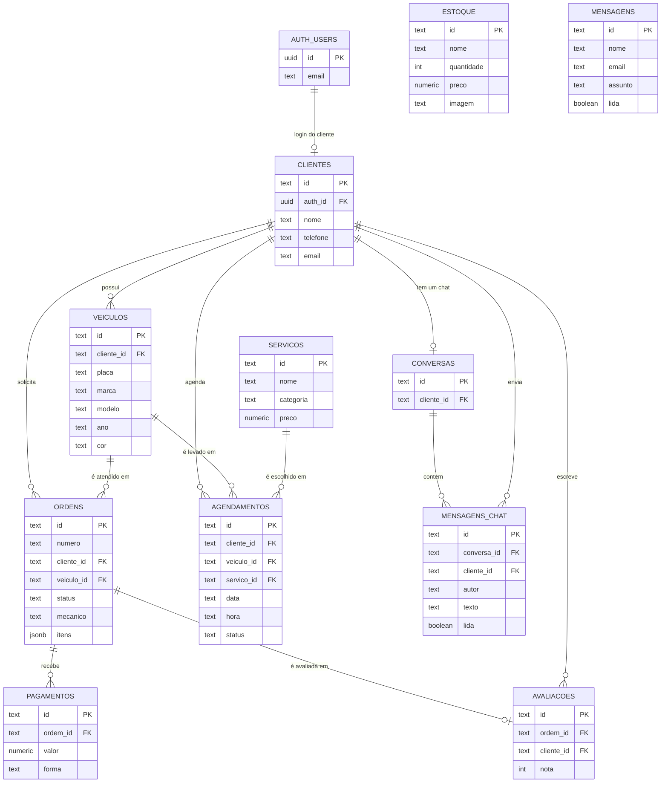

| Tabela | Descrição |
|---|---|
| `clientes` | Clientes da oficina (vinculados ao login do Supabase Auth) |
| `veiculos` | Veículos, vinculados a um cliente |
| `ordens` | Ordens de serviço (itens de peças e serviços em `jsonb`) |
| `estoque` | Peças disponíveis, com foto no Storage |
| `servicos` | Catálogo de serviços oferecidos |
| `agendamentos` | Agendamentos solicitados pelos clientes |
| `mensagens` | Mensagens recebidas pelo formulário de contato |
| `pagamentos` | Pagamentos registrados por ordem de serviço |
| `avaliacoes` | Avaliações dos clientes sobre as ordens |
| `conversas` | Uma conversa de chat por cliente |
| `mensagens_chat` | Cada mensagem do chat (uma linha por mensagem, sem perda em envios simultâneos) |

Ao excluir um cliente, veículo ou serviço, as ordens, agendamentos e avaliações continuam no histórico (a referência fica vazia); o chat do cliente excluído é apagado junto.

## Scripts disponíveis

| Comando | Descrição |
|---|---|
| `npm run dev` | inicia o front-end (Vite) |
| `npm run build` | gera a versão de produção |
| `npm run preview` | serve a versão de produção localmente |

## Roadmap

- [x] AT1 — front-end funcional com componentes, props e estado
- [x] AT2 — integração com Supabase (autenticação, banco de dados, Storage e Realtime)
